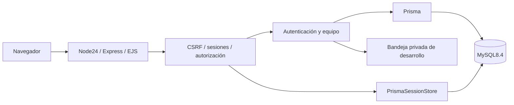

# Food Waste Fighter — Business Edition

Aplicación académica para una cafetería o restaurante pequeño: control de alimentos, aprovechamiento de ingredientes y coordinación del personal. Se utiliza un monolito Node.js con vistas renderizadas en el servidor.

**Estado:** fase 1 completada y fusionada mediante [PR #1](https://github.com/A-PerfectStranger/Food-Waste-Fighter-WebAvanzadas/pull/1). Se implementa la fase 2 de modelo de datos, autenticación y seguridad. El inventario, las métricas del dashboard, las recetas y el chat funcional corresponden a las fases siguientes. El esquema y el seed de esas entidades no representan funcionalidades terminadas. El estado y las evidencias se conservan en [PROGRESS.md](PROGRESS.md).

## Ejecución íntegra en GitHub Codespaces

No se requieren instalaciones en el equipo del estudiante.

1. En GitHub se abre **Code → Codespaces → Create codespace**, o se reconstruye el contenedor existente.
2. El devcontainer utiliza Node.js 24, Docker-in-Docker y el puerto3000. El comando post-create genera una `.env` privada sin sobrescritura, instala el lockfile, genera Prisma y compila CSS.
3. En la terminal de Codespaces se ejecuta:

```sh
npm run setup:env
npm ci
npm run build
npm run db:up
npm run db:migrate
npm run db:seed
npm run dev
```

4. El puerto3000 se abre desde el panel **Ports**, con visibilidad privada. El servidor escucha en `0.0.0.0`. `/health` comprueba HTTP y `/ready` consulta MySQL; el arranque exige disponibilidad de la base de datos.

La ejecución de la fase 1 en Codespaces fue confirmada por la persona responsable del proyecto. Las comprobaciones de fase2 se ejecutan en MySQL real y navegador local, incluyendo simulación del proxy HTTPS en pruebas HTTP; todavía no se dispone de una confirmación externa de los nuevos formularios en Codespaces.

### Configuración

[.env.example](.env.example) documenta las variables. `npm run setup:env` genera cinco secretos aleatorios independientes y guarda `.env` con permisos0600. El archivo existente se conserva. Los secretos y la bandeja privada no se incluyen en Git.

| Variables | Uso |
| --- | --- |
| NODE_ENV, HOST, PORT | Modo y escucha HTTP; Node24 es obligatorio. |
| APP_ORIGIN | Origen exacto del navegador: por ejemplo `http://localhost:3000`, o la URL HTTPS reenviada del Codespace. Se utiliza en CSRF y en los enlaces de recuperación. No admite rutas, credenciales ni parámetros. |
| TRUST_PROXY | `1` para el proxy de Codespaces; `0` para HTTP directo. |
| DATABASE_URL | Conexión MySQL de la aplicación, en el propio entorno de Codespaces. |
| SESSION_SECRET | Secreto de firma de sesiones, mínimo32 caracteres; se genera automáticamente. |
| MYSQL_* | Credenciales, base y puerto del contenedor de desarrollo. |
| TEST_DATABASE_URL, TEST_MYSQL_* | Base y contenedor de pruebas independientes, puerto3307. |
| BUSINESS_TIMEZONE | Zona de negocio prevista para la clasificación de caducidad de fase3. |

El origen se deriva del Codespace al crear `.env`. Si se reutiliza un archivo de otro entorno, se actualizan APP_ORIGIN y TRUST_PROXY. En producción se exige APP_ORIGIN con HTTPS; la cookie utiliza Secure en HTTPS, HttpOnly y SameSite=Lax. Un origen distinto puede provocar el rechazo correcto de formularios por CSRF.

El volumen `mysql_data` conserva desarrollo; `docker compose stop` mantiene los datos. Las contraseñas de un volumen inicializado no cambian al editar `.env`. No se requieren reinicios destructivos ni la ejecución del SQL original.

## Autenticación y apariencia

- `/` reutiliza la portada HTML original con sus clases y estilos.
- `/auth/register` crea empresa, ADMIN, inventario y sala General en una transacción. No se aceptan roles ni empresas ajenas desde el formulario.
- `/auth/login` verifica Argon2id y regenera la sesión; `/auth/logout` solo admite POST protegido.
- `/dashboard` muestra la cuenta protegida. Las métricas y el CRUD se incorporarán en fase3.
- `/team` permite a ADMIN consultar su equipo y crear EMPLOYEE dentro de su propia empresa.
- `/auth/forgot` y `/auth/reset` completan la recuperación con token de treinta minutos y un solo uso. Solo se almacena su hash en MySQL. El cambio revoca las sesiones anteriores.

Los formularios de `login.jsp`/`registro.jsp`, la portada `landing.html` y el CSS suministrados se adaptan a EJS. Se conservan Inter, el logo, la distribución y los valores originales de verde/gris. CSS, fuente y JavaScript se sirven localmente, con CSP y sin scripts inline/CDN. Se eliminan el documento duplicado y las estadísticas sin evidencia de la portada original.

### Bandeja de correo simulada

El seed crea los usuarios ficticios `admin@semilla.example` y `equipo@semilla.example` con contraseñas iniciales aleatorias que se descartan. El acceso se establece solicitando recuperación en `/auth/forgot`, consultando el JSON generado en **`work/outbox/` desde el editor privado**, y abriendo su enlace para definir una contraseña propia.

La bandeja está ignorada por Git, sus archivos tienen permisos0600 y no se sirven por HTTP. Los enlaces no se muestran en respuestas públicas ni en logs. Se trata de una simulación académica de correo, sin servicio SMTP. El seed es idempotente y no cambia las contraseñas ya establecidas.

## Pruebas

```sh
npm run build
npm run db:validate
npm test
# Base temporal separada; nunca se utiliza la de desarrollo:
docker compose --profile test up -d --wait mysql-test
npm run test:db
```

Las pruebas independientes cubren HTTP, encabezados, errores y configuración. Las de integración ejercitan MySQL, seed idempotente, arranque/apagado, registro/duplicados, contraseñas, sesión persistente y caducidad, permisos, aislamiento, CSRF, límites de intentos, recuperación/caducidad/reutilización/concurrencia y restricciones de datos. Las pruebas de inventario y de WebSockets se incorporarán con sus módulos.

El ejecutor rechaza bases sin sufijo `_test`, protocolos distintos de MySQL y el nombre de desarrollo antes de migrar. Solo se eliminan registros creados por las pruebas; el servicio mysql-test usa tmpfs y credenciales independientes. Los puertos3306/3307 no requieren reenvío público.

Un arranque con MySQL inaccesible puede tardar unos diez segundos: el adaptador consulta capacidades y luego disponibilidad, cada una con timeout de adquisición de cinco segundos. Se comprueba la salida segura sin listener HTTP.

Otros comandos: `npm start`, `npm run db:generate`, `npm run db:migrate` (migraciones revisadas), `npm run db:migrate:dev` (desarrollo de nuevas migraciones) y `npm run db:seed`.

## Arquitectura y documentación



- [Plan y auditoría de migración](docs/MIGRATION_PLAN.md).
- [Modelo de datos y diagrama ER](docs/DATA_MODEL.md).
- [Autenticación, seguridad y adaptación visual](docs/AUTHENTICATION.md).
- [Evidencias de fase1](docs/PHASE1_VERIFICATION.md).
- [Progreso, resultados y siguientes tareas](PROGRESS.md).

Stack: Node.js24 LTS, Express5, EJS, Tailwind4, Inter, Prisma7.10.1, MySQL8.4, Argon2id, express-session, Zod, Helmet, express-rate-limit, Vitest y Supertest. Socket.IO se incorporará al mismo servidor HTTP en fase4. No se implementan SPA ni microservicios en este bimestre.

## Contexto académico y atribución

Las referencias son `Food_Waste_Fighter-main.zip` y `Guía del Proyecto AppWebAv.docx`, aportadas al proyecto. Se reutiliza el HTML/JSP/CSS visual del ZIP por solicitud expresa; no se importa su manejo de contraseñas, sus cuentas ni su SQL destructivo. La autoría original no fue indicada en los adjuntos. Inter procede de `@fontsource/inter` y se distribuye bajo SIL Open Font License, incluida en el paquete.

El equipo, sus integrantes y roles siguen pendientes de completar con información real. Las fases3–5 incluyen CRUD/dashboard/recetas, WebSockets autenticados, rendimiento y documentación de defensa. No se ha creado `v1.0-b1` ni se presenta la fase2 como entrega final del bimestre.

### Uso de IA

Se utilizó OpenAI Codex como apoyo para auditoría, planificación, implementación, adaptación de plantillas, pruebas y documentación. Los resultados ejecutados y sus límites se registran en PROGRESS.md. Se requiere la revisión, comprensión y explicación del código por el equipo durante la defensa; no se atribuyen aportes individuales ni métricas no comprobadas.
