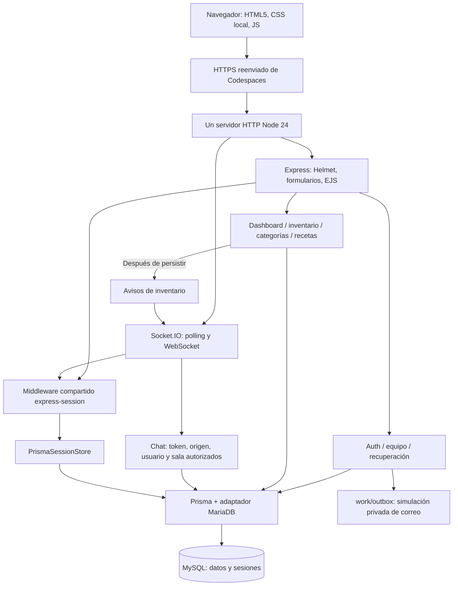

# Arquitectura implementada

El primer bimestre ejecuta un proceso Node.js 24 con servidor HTTP compartido
por Express 5 y Socket.IO 4. MySQL 8.4 es una dependencia de persistencia en
Compose. No existen frontend separado, API Gateway ni servicios de negocio
independientes. EJS produce HTML y JavaScript local añade validación, menú y
actualizaciones en vivo.

En HTTP directo local el navegador accede al servidor sin el proxy. En HTTPS
la cookie es Secure; TRUST_PROXY reconoce el único proxy de Codespaces. El
mismo token de sesión protege formularios y autentica el namespace Socket.IO.
Los eventos y cada destinatario vuelven a consultar sesión/usuario/empresa.

## Responsabilidades y reglas de dependencia

| Directorio / entrada | Responsabilidad real |
| --- | --- |
| src/server.js | Configuración, disponibilidad DB, servidor compartido y shutdown |
| src/app.js | Middleware, estáticos locales, vistas, rutas y errores |
| src/config | Zod de entorno, adaptador DB y store de sesiones |
| src/middleware | CSRF, usuario/rol, errores seguros |
| src/modules/auth, users | Hash, login/registro, sesión, recuperación y alta de empleados |
| src/modules/inventory | Esquema de entrada, repositorio SQL paginado, servicio y rutas |
| src/modules/dashboard, categories, recipes, expiration | Métricas, catálogo, preparación/coincidencia y fechas civiles |
| src/modules/chat | Consulta/render de General, historial, envío, autorización y presencia |
| src/public/realtime.js | Socket local, DOM con textContent y banner sin recarga |
| scripts | Setup, guard de test DB, regresión, navegador y medición |
| prisma | Esquema, migraciones revisadas y seed ficticio idempotente |

Todos los módulos permanecen en el mismo proceso y comparten Prisma. La
separación facilita cambios futuros, pero no se presenta como una separación
de servicios ya realizada. Notificaciones se coordinan en chat.socket.js y en
las rutas de inventario; no se inventa un módulo notifications independiente.

## Datos y consistencia

[DATA_MODEL.md](DATA_MODEL.md) contiene el ER completo de las 11 entidades reales:
Company, User, Inventory, Category, FoodItem, Recipe, RecipeIngredient, ChatRoom,
ChatMessage, PasswordResetToken y Session. Las relaciones de negocio usan claves
compuestas de empresa; las consultas añaden companyId. Cantidades usan Decimal,
fechas de alimento SQL DATE y eventos timestamps.

Registro y reset son transacciones. El inventario emite únicamente después del
commit de su operación. La entrega socket no es parte de una transacción SQL:
puede perderse un aviso y la consulta persistida sigue siendo la autoridad.
No se afirma entrega exactamente una vez. La presencia y límites están en la
memoria del monolito, mientras mensajes/sesiones sobreviven a reinicios.

La paginación del inventario usa skip/take; el historial de chat usa cursor por
fecha e ID. El informe de rendimiento distingue esas consultas de los planes
SQL representativos. Los índices existentes no convierten contains en una
búsqueda de prefijo.

## Fronteras de confianza

El navegador no decide identidad, rol ni empresa. Los identificadores de ruta,
sala y cursor se autorizan, y las claves foráneas aportan defensa adicional.
La bandeja de reset es privada e ignorada, nunca estático web. `.env` y el
almacén de sesiones contienen secretos y quedan fuera de la evidencia pública.
CSP restringe scripts/fuentes al origen local; Helmet y el token CSRF no se
sustituyen por la mera existencia de una cookie.

El modelo no incluye movimientos contables, nutrición verificada, reducción de
pérdidas medida ni editor de recetas; esas capacidades no se atribuyen al código.
El plan futuro se limita a [second-bimester-roadmap.md](second-bimester-roadmap.md).
