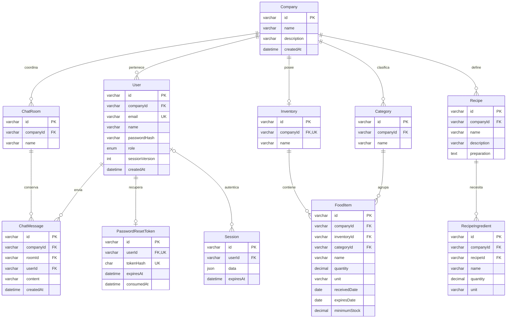

# Modelo de datos del monolito

Estado: implementado mediante `20261107000100_bootstrap` y `20261107000200_tenant_auth`. MySQL 8.4 y Prisma 7.10.1. El segundo cambio es aditivo: no se eliminan ni se importan tablas del proyecto Java.

## Restricciones e índices

- `User.email` es único globalmente y se normaliza con trim/minúsculas antes de persistir. Los roles admitidos son ADMIN y EMPLOYEE. El registro público crea un nuevo ADMIN; el rol no se acepta desde el formulario.
- Una empresa tiene un inventario. Los nombres de categorías y salas son únicos dentro de cada empresa. Los identificadores de empresa se resuelven a partir del usuario autenticado.
- Las relaciones alimento–inventario y alimento–categoría usan claves compuestas `(id, companyId)`. Un alimento no puede utilizar una categoría o inventario de otra empresa, incluso mediante una consulta directa.
- Las relaciones ingrediente–receta y mensaje–sala/emisor también incluyen `companyId`. Una clave externa impide asociar el emisor de otra empresa a un mensaje de una sala local.
- Los índices de búsqueda comienzan por `companyId`; alimentos añaden nombre y fecha de caducidad. El historial del chat cuenta con un índice por sala, empresa, fecha e identificador para su futura paginación estable.
- Las cantidades son `DECIMAL(12,3)` y las fechas de alimentos son `DATE`. Las comprobaciones SQL exigen cantidades/stock no negativos, caducidad posterior o igual al ingreso y cantidad positiva en ingredientes. Las comprobaciones CHECK se mantienen explícitamente en la migración; no se representan como reglas Prisma.
- Las categorías con alimentos tienen borrado restringido. Las entidades dependientes de empresa/usuario usan cascada según el esquema. Una futura eliminación de empresa deberá eliminar primero los alimentos si existen categorías referenciadas; no se expone esa operación en esta fase.
- Solo se persiste el hash SHA-256 del token aleatorio de recuperación. Hay como máximo una fila por usuario, con caducidad y fecha de consumo. Un nuevo envío reemplaza el enlace anterior.
- `Session` persiste el contenido de express-session como JSON, con índice de caducidad y referencia opcional al usuario. Las sesiones anónimas no tienen usuario. La sesión almacena el identificador y la versión de autenticación; rol y empresa se consultan nuevamente en MySQL en cada petición protegida.

## Datos de demostración

El seed crea una cafetería ficticia, dos usuarios (ADMIN/EMPLOYEE), inventario, categoría, alimento decimal, receta/ingrediente y sala/mensaje. Los identificadores son estables, las operaciones son idempotentes y los registros existentes no se sobrescriben. Las contraseñas iniciales son aleatorias y se descartan; el acceso se establece mediante recuperación de contraseña en la bandeja privada de desarrollo.

La fase 3 reutiliza este esquema para el CRUD, categorías, métricas, caducidad y consulta de recetas; no añade migraciones. El esquema/seed del chat todavía prepara la fase 4 y no implica que haya comunicación en tiempo real.
