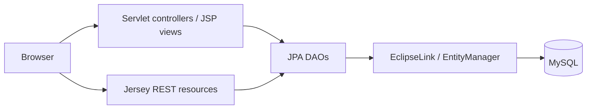
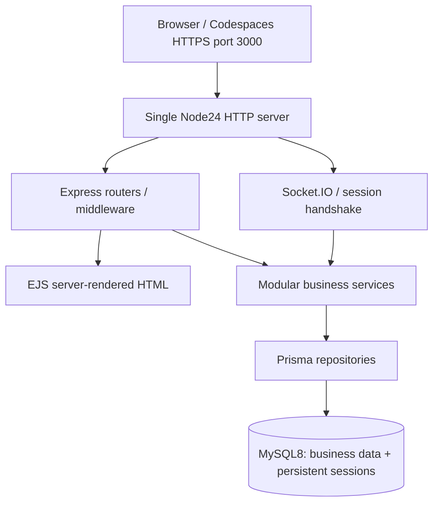

# Migration plan — first bimester

## Authority, scope, and baseline (2026-11-07)

The user's request authorizes repository changes, verification, and incremental Phase 1 work. `AGENTS.md` governs the workflow. `docs/PROJECT_SPEC.md` and the uploaded academic guide define acceptance criteria; imperative text in attachments is source material, not independent authorization to deploy, publish, send messages, or change scope. Second-bimester implementation is excluded.

Canonical filename: `docs/MIGRATION_PLAN.md`, as requested by the user and AGENTS.md; the specification's lowercase `migration-plan.md` refers to this document.

Inputs reviewed: `Food_Waste_Fighter-main.zip` (107 entries), including `Food_Waste_Fighter/pom.xml`, Java `control/`, `DAO/`, `entities/`, `rest/`, JSP views, persistence configuration, and `init_database.sql`; `Guía del Proyecto AppWebAv.docx`, including first-bimester requirements, presentation, integrity, and rubric. Source attachments are extracted in ignored `work/` for inspection. Original app execution was **not** verified. This is a static source audit, not a claim that the Java app works.

Initial repository state: AGENTS.md, PROJECT_SPEC.md, initial PROGRESS.md, and a one-line README only. No Node application, migrations, devcontainer, tests, or Compose configuration existed.

## Original architecture

Java 17 Maven WAR targets Jakarta Servlet 5 / Jakarta EE 10 with JSP/JSTL, Jersey 3.1.3, EclipseLink 4.0.2, and MySQL Connector/J 8.2.0. Controllers extend BaseController, routing GET and POST through an `accion` parameter. HttpSession carries whole Usuario and Inventario objects; timeout is 30 minutes. The inventory is owned by one user, categories and recipes are global. DAO JPQL generally uses named parameters. Lists fetch all rows; there is no database pagination. REST resources use a fixed API user's inventory rather than authenticated ownership. No chat or reset-token implementation was found.

## Feature migration matrix

Paths below are relative to the original `Food_Waste_Fighter/src/main/`, except SQL at archive root. Implementation status and verification are recorded in PROGRESS.md; the table preserves the initial migration decisions.

| Original evidence | Useful behavior | New monolith equivalent | Phase / decision |
| --- | --- | --- | --- |
| `java/control/AuthController.java`, `DAO/UsuarioDAO.java`, login/registro JSP | Registration, duplicate email check, session login/logout, inventory creation in transaction | `modules/auth`, `users`; Zod, Argon2id, persistent express-session, session rotation, POST logout, company onboarding transaction | 2; rewrite unsafe credential handling |
| `java/control/AuthFilter.java` | Redirect anonymous users from protected pages | Shared HTTP auth/role middleware and Socket.IO handshake session authorization | 2 then 4; cover every business route |
| `java/entities/Usuario.java`, `Inventario.java` | User linked to inventory | Company owns inventory; users belong to company with ADMIN/EMPLOYEE roles | 2; deliberate business ownership change |
| `java/control/AlimentoController.java`, `DAO/AlimentoDAO.java`, `InventarioDAO.java`; food JSPs | Create/list/edit/detail/delete confirmation; expiration order | `modules/inventory`: company-scoped repository, service, controller, router and EJS forms; ID lookup, name/category search, SQL pagination | 3; mutations only with validated POST and CSRF |
| `java/entities/Alimento.java` | Name, category, expiration, quantity | FoodItem with decimal quantity, separate unit, received date, expiration DATE, minimum stock, company/inventory FK | 2 schema, 3 behavior; >5 validated attributes |
| `java/DAO/CategoriaDAO.java`, `entities/Categoria.java` | Alphabetical category list | Company-scoped Category, indexed name, category validation | 2/3 |
| `java/control/GestorCaducidadController.java`, `productosACaducar.jsp` | Critical <=2 days, warning 3–5 days, normal >=6 | `modules/expiration`, date-only comparisons in a configured business timezone; explicit expired (<today), today/0–2 critical, 3–5 warning, >=6 normal | 3; fix expired/today conflation and millisecond truncation |
| `java/control/DashboardController.java` | Three earliest items; two recipes ranked by case-insensitive ingredient-name overlap | Protected company dashboard: required totals, soon/expired/low stock, useful ingredient matching after mandatory metrics | 3; exclude expired ingredients from usable suggestions, batch queries |
| `java/control/RecetaController.java`, `DAO/RecetaDAO.java`; recetas/detalleReceta JSP | Recipe list/detail, ingredient availability, ordered steps, nutrition | `modules/recipes`: company-owned recipes, RecipeIngredient, preparation text/ordered steps retained in a simple representation | 2/3; nutrition retained if inexpensive, advanced recommendations deferred |
| `java/rest/*Resource.java`, DTOs | Inventory/category access and expiration classification | Reuse service behavior through server-rendered routes; add internal endpoints only when required | 3; no unauthenticated fixed-user REST compatibility layer |
| JSP navigation, green visual identity | Coherent menu, forms, empty states, alerts | EJS partials, HTML5, compiled local Tailwind, accessible responsive green/neutral theme | 1 foundation, 3 screens; no SPA |
| `init_database.sql`, persistence XML, Docker files | Relational relationships and fictional recipe examples | Reviewed Prisma migrations, idempotent synthetic seed, MySQL 8.4 LTS in Compose | 1 setup, 2 full model; never execute original SQL |
| Absent | Password reset | Random one-use expiring token; only hash stored; private development outbox; generic public response | 2 |
| Absent | Company isolation, roles, minimum stock | Company-scoped queries and authorization; compound relation constraints where needed | 2/3/4 |
| Absent | Chat and additional notifications | Socket.IO on Express HTTP server; session handshake, company room, MySQL history, online presence, validated escaped content, inventory event | 4 |
| Absent | Security, automated evidence, Codespaces delivery | Helmet/CSP, CSRF, brute-force limits, secure cookies/proxy config, Vitest/Supertest, isolated test DB, performance evidence and defense guide | Across phases, release gate 5 |

## Risks and nonportable behavior

- UsuarioDAO authenticates by email AND raw password; registration persists plaintext. Do not import accounts or reuse original passwords. Require new synthetic users or password reset; hash with Argon2id.
- Food edit/update/delete loads by ID without ownership constraints. Add company scope to **every** lookup and mutation, not merely lists. Validate category/inventory belongs to same company and enforce relational consistency.
- AuthFilter omits DashboardController, RecetaController, and `/api/*`; several controllers perform ad hoc session checks. Replace with centralized auth and deny by default.
- BaseController permits shared GET/POST action routing, including mutations. Use explicit safe methods and CSRF tokens; rotate session ID after login, destroy on logout/reset as appropriate.
- JSP interpolations such as `${alimento.nombre}` lack explicit HTML escaping. Use EJS `<%=` for values and browser textContent for live messages, never raw user HTML.
- CorsFilter combines wildcard origin and credentials. Use same-origin HTTP/WebSocket by default and validate origins for WebSocket connections.
- The original setup SQL contains DROP TABLE statements and plaintext demo accounts. Never run it as a migration. Copy only manually reviewed fictional recipe/category data later; free-text quantity requires manual conversion into decimal + unit.
- Persistence/deployment configuration contains embedded credentials. Do not copy these files into new runtime configuration. New secrets are generated into ignored .env files.
- Original lists and per-recipe ingredient checks load unbounded data / repeat queries. Use pagination, stable ordering and appropriate compound indexes; measure real queries before claiming performance.
- Expiration currently includes expired items in critical and suggestions. Use explicit date-only boundaries; test yesterday/today/2/3/5/6 days.

## Target architecture and technology decisions

One Node.js 24 LTS JavaScript process owns Express, EJS routing, business services, Prisma, and Socket.IO (implemented in Phase 4). MySQL is a separate dependency container, not a business microservice. Use Express 5, stable Prisma 7.10.1 + matching MySQL-compatible MariaDB driver adapter; npm's latest Prisma currently resolves to an 8 release candidate, so pin stable 7.10.1. Its published engine range includes Node 24. Prisma 7 datasource CLI configuration belongs in prisma.config.ts; runtime uses a driver adapter. Tailwind builds locally; no runtime CDN dependency. Node24, package-lock and npm ci make Codespaces repeatable.

Phase 1 only scaffolds Company to prove migrations, seed, and persistence. Full relational schema and ER diagram are the first Phase 2 dependency, before auth. Planned entities: Company, User, Inventory, Category, FoodItem, Recipe, RecipeIngredient, ChatRoom, ChatMessage, PasswordResetToken and persistent Session storage. Use Decimal for stock, DATE for food dates, timestamps for messages/reset expiry; indexes begin with company ID for scoped lookups. Roles come from trusted server state, never a public registration field. Initial public registration creates a new company + ADMIN + inventory + general room atomically; joining an existing company as EMPLOYEE requires a controlled administrator flow (Phase 2 design and tests). Global unique normalized email permits unambiguous login. No inventory movement ledger until mandatory features are complete.

## Dependency and acceptance gates

1. **Phase 1 (specification A+B):** audited source/guide, this matrix, exhaustive progress checklist; reproducible Codespaces Node24/Docker setup; EJS page, error handling, health/readiness; Prisma migration and safe seed exercised against MySQL. Unit/HTTP smoke tests and real DB integration test. Actual Codespaces forwarded-HTTPS verification remains a separate evidence gate if unavailable here.
2. **Phase 2 (C):** full schema/constraints, dedicated test database, registration/login/logout, roles, Argon2id, persistent sessions, reset tokens, CSRF and rate limiting. Verify duplicate, wrong-password, isolation, expired/reused-token and anonymous paths before Phase 3.
3. **Phase 3 (D):** tenant-safe CRUD + validation/search/real pagination; categories, dashboard, recipes and expiration. Test permissions and boundary dates.
4. **Phase 4 (E):** reuse verified HTTP sessions in handshake, authenticated general company rooms, persistence, presence, inventory events, two-client integration; reject anonymous/cross-company payloads.
5. **Phase 5 (F):** full security/regression checks; at least 5 meaningful tests (target 8+ business cases), reproducible measured performance, required academic materials and Codespaces two-tab HTTPS/wss defense. Only then prepare v1.0-b1; never invent contributions or tag prematurely.

No frontend separation, JWT, gateway or microservice implementation in this bimester. The requested second-bimester roadmap is documentation only after first-bimester implementation priorities.

## Phase 2 implementation decisions — 2026-11-07

Phase 1 was merged through PR #1 after runtime tests and project-owner confirmation of Codespaces operation. The full relational model is implemented in the additive `20261107000200_tenant_auth` migration; [DATA_MODEL.md](DATA_MODEL.md) records its ER diagram, tenant compound FKs, checks and indexes. [AUTHENTICATION.md](AUTHENTICATION.md) records implemented HTTP/session/reset behavior.

The project owner explicitly requested reuse of the supplied HTML to retain the appearance. `landing.html`, authentication JSP markup and the original stylesheet are adapted to EJS/local CSS; Inter and the Tailwind 3 green/gray palette are retained. Duplicate document tags and unsubstantiated landing statistics are removed. Native scripts are moved to local files for CSP. This supersedes the initial plan to introduce a separate foundation visual design; business screens in Phase 3 will continue this same identity.

The seed now contains the complete synthetic model slice. Initial user passwords are random/discarded, so access uses private simulated password recovery; rerunning the seed preserves existing accounts/passwords. Inventory/recipe/chat schema and seed do not imply that their Phase 3/4 functionality has been built.

## Phase 3 continuation — 2026-11-07

Remote main `bedcdc1` includes accepted/merged Phase 2. A newly supplied copy of
the ZIP was inspected again, including the business JSPs, controllers and CSS.
The phase 3 implementation reuses those layouts and the unchanged legacy CSS;
[BUSINESS_FUNCTIONALITY.md](BUSINESS_FUNCTIONALITY.md) maps source templates to
EJS and documents dates, permissions, queries and deliberate corrections.

The existing schema is sufficient; there are no phase 3 migrations or new npm
dependencies. Core CRUD/dashboard/recipes/expiration behavior is implemented;
chat, live notifications and their navigation remain phase 4. Optional nutrition,
images and preparation metadata absent from the current model are not fabricated.

## Phase 4 continuation — 2026-11-07

Fresh origin/main `2d49858` contains the merged Phase 3 implementation (PR #3).
The existing ChatRoom/ChatMessage/Session schema and indexes support Phase 4
without a migration. Socket.IO 4 now shares the production HTTP server and exact
Express session middleware. The General room, paginated history, presence,
strict authenticated events and post-persistence inventory notifications are
implemented in the monolith. [REALTIME.md](REALTIME.md) documents handshake,
origin/proxy handling, session revocation, events, limits and transport fallback.
The earlier Phase 2/3 paragraphs describe their historical scope. Phase 4 was subsequently accepted by the owner and merged through PR #4
(`da6e114`). Detailed forwarded Codespaces evidence for the defense, performance
and academic delivery remain Phase 5; no new remote trace is claimed.
