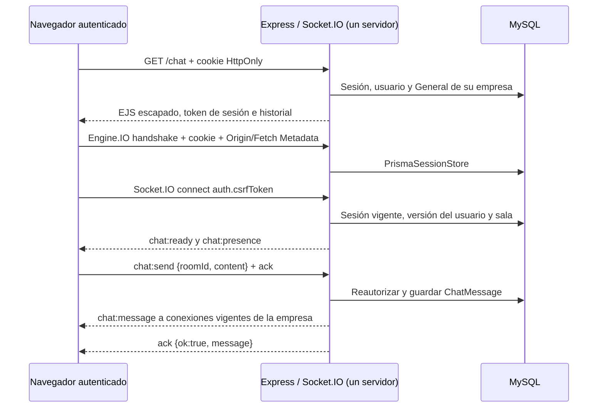

# Chat y avisos en tiempo real — fase 4

## Arquitectura y acceso

`src/server.js` crea un único servidor HTTP para Express y Socket.IO 4. El
proceso utiliza el mismo Prisma/MySQL que autenticación e inventario; no hay
servicio externo ni proceso de chat separado. `attachRealtime` recibe el
middleware real de express-session, con el mismo secreto, cookie y
PrismaSessionStore. Socket.IO sirve su cliente local en `/socket.io/socket.io.js`.

`/chat` exige autenticación HTTP y renderiza la sala **General** de la empresa,
los últimos 50 mensajes persistidos y el formulario. Navbar y dashboard incluyen
acceso funcional. El cliente de las demás pantallas protegidas también conecta
para mostrar avisos de inventario sin recargar la página.

## Handshake y autorización

- El origen exacto debe coincidir con `APP_ORIGIN`. Se rechazan señales
  `cross-site`/`same-site`; fuera de la alternativa acotada del proxy descrita
  abajo, se rechazan orígenes ajenos y `Origin:null`.
- Chromium omite Origin en GETs de polling del mismo origen. Ese único caso
  exige `Sec-Fetch-Site:same-origin` y transporte `polling`.
- Con `TRUST_PROXY=1`, APP_ORIGIN HTTPS y `X-Forwarded-Proto:https`, se permite
  la señal de navegador `Sec-Fetch-Site:same-origin` si el proxy reescribe Origin,
  igual que la regla acotada de formularios. No se confía solo en Host reenviado.
- Además se exige `auth.csrfToken`, comparado en tiempo constante con el token
  de la sesión. El HTML autenticado lo proporciona; la cookie sigue HttpOnly.
  Tener una conexión Engine.IO no implica estar autenticado en Socket.IO.
- Identidad, nombre y empresa se obtienen del usuario vigente en MySQL. La sala
  se resuelve por `(companyId, name=General)`; no hay evento de unión arbitraria.
  Los payloads son objetos Zod estrictos: identidad/empresa extra se rechazan.
- Se comprueba la sesión persistida, su caducidad y sessionVersion en cada
  evento y antes de entregar mensajes, avisos o presencia a cada destinatario.
  Logout, recuperación de contraseña y cambios de empresa invalidan el socket.
  Un barrido cada 15 segundos retira sesiones revocadas aunque no haya actividad.
  Los sockets no guardan ni prolongan copias antiguas de sesiones; la actividad
  HTTP conserva la renovación normal. El usuario vuelve a iniciar sesión al
  caducar la sesión.

## Contrato de eventos

Todos los eventos solicitados por el cliente requieren callback de confirmación.

| Dirección / evento | Datos y comportamiento |
| --- | --- |
| Servidor → `chat:ready` | `{roomId, userId}`. Identidad resuelta por servidor. |
| Cliente → `chat:send` | `{roomId, content}`. Ack `{ok:true, message}` tras persistencia y difusión. |
| Servidor → `chat:message` | `{id, roomId, content, createdAt, sender:{id,name}}`; timestamp ISO. Incluye al emisor; el cliente deduplica por ID. |
| Cliente → `chat:history` | `{roomId, before?}`. Ack `{ok:true, messages, hasMore}`. Últimos 50 o anteriores al cursor, presentados cronológicamente. |
| Servidor → `chat:presence` | `{users:[{id,name}]}`. Usuarios distintos de la empresa, sin contar pestañas duplicadas; altas/bajas y reconciliación periódica. |
| Servidor → `inventory:changed` | `{itemId, action, name, expiration, nearExpiry}`; action created/updated/deleted, nombre/estado null al borrar. |

El historial usa el índice existente `(roomId, companyId, createdAt, id)`, un
cursor previamente autorizado y orden estable por timestamp/ID, incluso si las
fechas coinciden. No se carga todo el historial en memoria. Cambiar roomId o
usar un cursor de otra empresa devuelve un error genérico.

Los errores de evento son `{ok:false, code, message}`: AUTH_REQUIRED,
INVALID_INPUT, FORBIDDEN, RATE_LIMIT o CHAT_UNAVAILABLE. Los errores de conexión
incluyen AUTH_REQUIRED, CONNECTION_LIMIT y CHAT_UNAVAILABLE; el rechazo de origen
se realiza antes, en Engine.IO. No se envían errores Prisma, URLs ni secretos.

## Validación, límites e interfaz

Contenido: texto recortado, 1–2000 caracteres, sin controles no imprimibles;
se permiten saltos de línea y Unicode. EJS escapa el historial y el cliente usa
`textContent` para mensajes, nombres y avisos. No hay HTML interpretado ni
scripts inline/CDN; se conserva Helmet/CSP y la paleta verde/gris existente.

Límites del monolito: 5 conexiones por usuario, 100 por empresa, 60 peticiones de
historial/envío por minuto y usuario compartidas entre pestañas/reconexiones,
16 KiB por paquete y 10 segundos para completar la conexión de namespace. Los
contadores de límites/presencia están en memoria del proceso; los mensajes y
sesiones están en MySQL. Estos límites no sustituyen protección de infraestructura.

El cliente empieza con polling y negocia el upgrade WebSocket del mismo origen.
En HTTPS se usa wss; si el upgrade no está disponible, continúa con polling.
La interfaz indica conexión/desconexión, desactiva envíos sin conexión y conserva
el texto si falta confirmación. El timeout de ack es de 10 segundos. No se
reintenta un envío automáticamente: una confirmación perdida podría corresponder
a un mensaje ya guardado. Al reconectar se sincroniza la página más reciente y
se conservan los mensajes recibidos durante esa consulta; el botón permite cargar
páginas anteriores. No se promete entrega exactamente una vez ni historial sin
conexión. SIGINT/SIGTERM cierra sockets y HTTP antes de desconectar Prisma.

## Inventario

Las rutas HTTP existentes emiten solo después de una creación, edición o borrado
persistido y autorizado. Un formulario inválido o acceso ajeno no emite. Cada
receptor se reautoriza antes de entregar el evento. La proximidad se calcula en
BUSINESS_TIMEZONE: hoy a cinco días inclusive. También se indica si está caducado.

El banner aparece en las pantallas protegidas sin recarga, con enlace al inventario.
Los contadores y tablas siguen siendo la consulta de su carga inicial; el aviso
permite consultar el estado actualizado. Los avisos no tienen historial propio.
Un fallo de entrega no transforma una mutación ya guardada en un falso error HTTP.

## Verificación y demostración

`npm test` y `npm run test:db` incluyen política de origen y clientes reales de
Socket.IO contra el servidor y MySQL aislado: rechazo anónimo/token/cookie/origen,
dos personas, persistencia/reconexión, aislamiento de sala/cursor/difusión,
validación/XSS, paginación estable, presencia, polling, límites, logout/caducidad/
versión, avisos de CRUD y cierre de conexiones activas. Los resultados concretos
y las pruebas con Chromium HTTP/HTTPS local (incluido wss y cookie Secure)
se registran en PROGRESS.md.

Para demostrarlo, ADMIN crea un EMPLOYEE en `/team`; ambas personas inician sesión
en perfiles de navegador distintos y abren `/chat`. Envían mensajes y comprueban
presencia e historial al recargar. Una persona mantiene el chat abierto mientras
la otra registra un alimento con caducidad de hoy a cinco días: aparece el aviso.
Una empresa distinta no recibe mensajes ni avisos. Dos pestañas del mismo usuario
sirven para probar varias conexiones, pero no representan dos usuarios distintos.

La aceptación por el HTTPS reenviado real de Codespaces, incluido wss y dos
usuarios, sigue siendo una evidencia externa pendiente de fase 5. Las pruebas
locales no la sustituyen.

Trabajo asistido por OpenAI Codex; el equipo debe revisar y poder explicar el
handshake, las autorizaciones, los eventos y los transportes.
